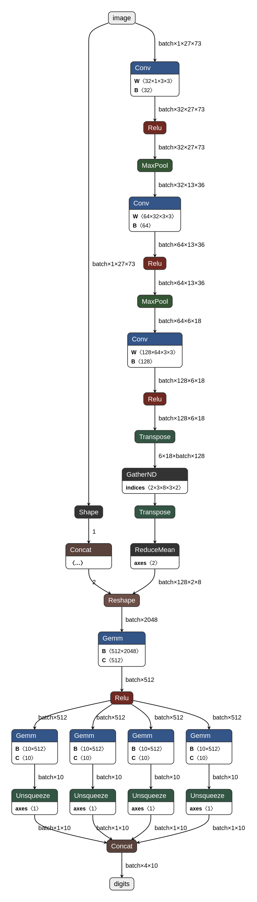
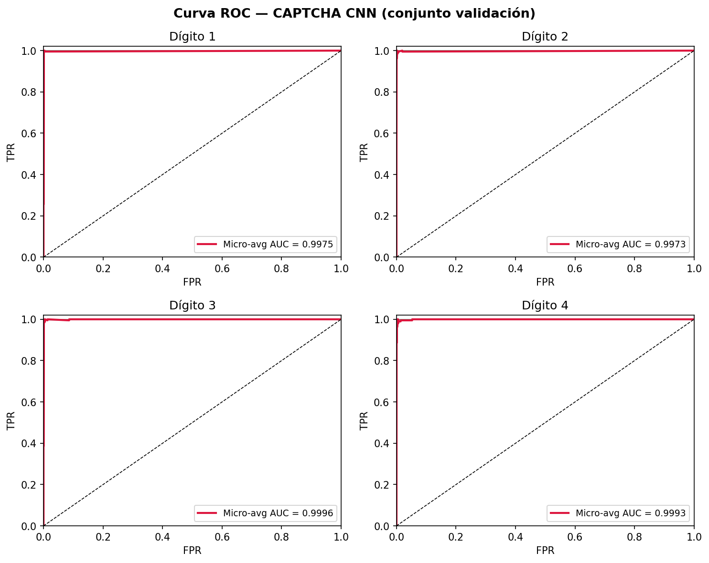

# CaptchaCNN

Red convolucional **multisalida** en PyTorch que reconoce captchas numéricos de longitud
fija: cuatro dígitos en imágenes de 27×73 píxeles en escala de grises. Entrenada de cero,
evaluada y exportada a ONNX.

Junio de 2026.

## Diseño

La idea central: en vez de una sola salida que intente predecir el número de cuatro cifras
completo (10.000 clases posibles), la red tiene **un *backbone* convolucional compartido y
cuatro cabezas clasificadoras independientes**, una por posición, cada una eligiendo entre
diez clases. Probado contra un clasificador de salida plana, esta separación mejora la
precisión: cada posición aprende de forma especializada.

### Backbone

| Bloque | Capas | Salida |
|---|---|---|
| 1 | `Conv2d(1→32, 3×3)` + BatchNorm + ReLU + MaxPool(2) | 32 × 13 × 36 |
| 2 | `Conv2d(32→64, 3×3)` + BatchNorm + ReLU + MaxPool(2) | 64 × 6 × 18 |
| 3 | `Conv2d(64→128, 3×3)` + BatchNorm + ReLU + AdaptiveAvgPool(2×8) | 128 × 2 × 8 |

Clasificador compartido: `Flatten → Linear(2048→512) → ReLU → Dropout(0.5)`.
Cuatro cabezas: `Linear(512→10)` cada una.

**1.162.728 parámetros** en total. El `AdaptiveAvgPool` del último bloque hace que la red no
dependa del tamaño exacto de la entrada.



*Esquema obtenido abriendo el `.onnx` en [Netron](https://netron.app).*

## Resultados

30 épocas, lotes de 64, Adam con tasa de aprendizaje 1e-3.

| Posición | Precisión | AUC (macro OvR) |
|---|---|---|
| Dígito 1 | 99,65 % | 1,0000 |
| Dígito 2 | 99,70 % | 1,0000 |
| Dígito 3 | 99,40 % | 0,9999 |
| Dígito 4 | 99,40 % | 0,9999 |
| **Imagen completa** | **98,35 %** | ~1,0000 |

La precisión global (98,35 %) es menor que la de cada dígito porque exige acertar **las cuatro
posiciones a la vez**: basta un fallo en una para que la imagen cuente como error.



**Latencia:** 0,183 ms ± 0,077 ms por imagen, medido sobre 200 ejecuciones con 50 de
calentamiento previo, en una GPU NVIDIA RTX 4060 Laptop.

**Tamaño del modelo:** 4,45 MB en `.pth` y 4,47 MB en `.onnx`.

## Exportación a ONNX

El modelo se exporta con *opset* 18 y los pesos embebidos, así que se puede ejecutar con
ONNX Runtime sin arrastrar PyTorch como dependencia. Está en
[`model/captcha_cnn_full.onnx`](model/).

## Conclusiones

- **Las cuatro cabezas independientes son la decisión que más aporta.** Separar el problema
  por posición en lugar de predecir el número entero reduce drásticamente el espacio de
  clases y mejora la precisión medida.
- **La profundidad importa, y se entiende por qué.** Con uno o dos bloques convolucionales
  la precisión cae: las primeras capas detectan bordes y texturas, y hacen falta capas
  posteriores para combinarlas en formas de dígitos. Con poca profundidad el campo receptivo
  no llega a cubrir un dígito completo y el modelo tampoco aprende a ignorar el ruido, las
  rotaciones y las sobreimpresiones del captcha.
- **Un AUC de ~1,0 no significa que el problema sea difícil.** Mide separación entre clases
  sobre un conjunto de validación de imágenes sintéticas y homogéneas; el mérito está en la
  arquitectura y el entrenamiento, no en la dificultad del dato.

## Alcance

Conviene decirlo claro: esto reconoce **captchas numéricos sintéticos de cuatro dígitos** de
un conjunto de datos académico. No tiene nada que ver con los sistemas anti-bot que se usan
hoy en producción (reCAPTCHA, hCaptcha, Turnstile), que no son imágenes de dígitos y que
combinan señales de comportamiento, reputación y navegador. Es un ejercicio de visión por
computador, no una herramienta de evasión.

## Ejecutarlo

El conjunto de datos **no está en el repositorio**. El script espera un
`captcha-dataset.zip` en la carpeta superior, con las imágenes `.png` organizadas por
subcarpetas de partición y el número de cuatro dígitos como nombre de fichero.

```bash
pip install -r requirements.txt
python src/train.py
```
